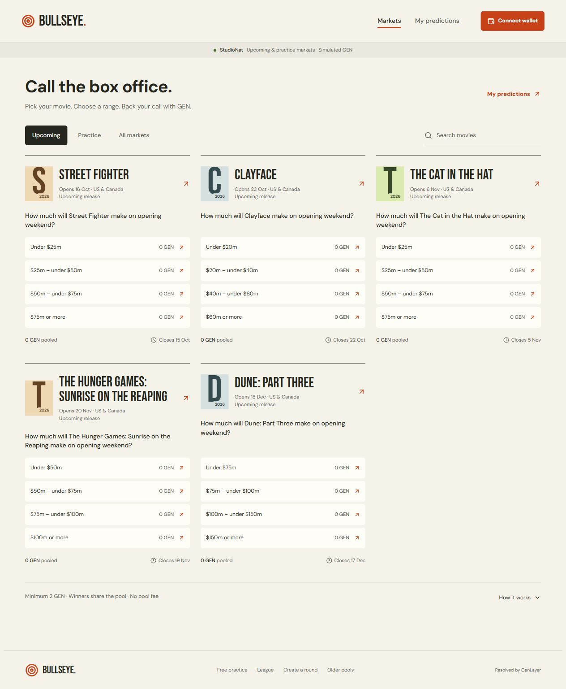

# Bullseye

A Film and Music prediction platform powered by GenLayer. Forecast opening-weekend box office or Billboard 200 album debuts, stake simulated StudioNet GEN, and collect a proportional share of the winning pool. Film accepts 2–100 GEN; Music accepts 0.01–100 GEN. Validators compile Music questions and independently verify archived complete-chart evidence. Free Film and Music predictions also share a season leaderboard. No pool fee is deducted.

Music+ adds bonded identity challenges before staking. Independent validators finalized genuine UPHELD, AMENDED and VOIDED cases against frozen Billboard reporting and release evidence; an upcoming Van Halen reissue also received a real edition amendment. Three upcoming GEN pools are open with unknown results. The contract defaults to a 24-hour review; this StudioNet demonstration discloses a ten-minute window, 0.004 GEN listing deposit and 0.001 GEN challenge bond. The complete 0.028 GEN proof package was collected back through verified native credit. [Proof and limitations](docs/MUSICPLUS-WIP.md), [identity-review tutorial](docs/TUTORIAL-MUSIC.md) and [architecture](docs/ARCHITECTURE.md). Film and the [previous Music release](https://bullseye-genlayer.vercel.app/music/previous) remain readable.

**[Live app](https://bullseye-genlayer.vercel.app) · [Two-minute demo](docs/DEMO.md) · [Tutorial](docs/TUTORIAL.md) · [Portal submission](docs/SUBMISSION.md) · [Verification](docs/VERIFICATION.md)**



## Use it

The default directory has five upcoming films: Street Fighter, Clayface, The Cat in the Hat, The Hunger Games: Sunrise on the Reaping and Dune: Part Three. Each has a finalized specification, one shared pool, a cutoff before previews and an unknown outcome. GEN remains held until the verified result or void. [Dates and rules](docs/UPCOMING.md).

Practice contains Barbie, Oppenheimer and Dune: Part Two. Their published results are known; the first stake opens a shared two-minute GEN session. Earlier claims remain available when a new session starts. Free points practice is a separate, wallet-free action on historical pages and `/practice`; it is excluded from competitive rankings.

Browse without a wallet. Connect MetaMask with the GenLayer wallet plugin through the header, select a range, enter at least 2 GEN and sign. The ticket and My predictions follow confirmation and settlement automatically. Collect available GEN with one signature. The contract reserves the attempt, independently verifies exact native credit, then marks it paid after finality. A confirmed failed transfer opens a Retry collection button; pending or uncertain receipts stay locked. Open pages drive settlement while the daily scheduler awaits its server authentication setting.

**Network: StudioNet, chain 61999. All GEN is simulated development currency.** There is no mainnet or Bradbury deployment, real-money wagering or completed upcoming-film payout claim.

## Why GenLayer

A publisher page contains domestic, worldwide, lifetime and individual-weekend figures. A numeric parser cannot decide which number satisfies an ordinary-language film rule. Bullseye validators first independently check the proposal against the canonical specification, then independently fetch The Numbers and extract the exact number for that event. Validators also check the stored quotation against the page they read.

Deterministic code controls deadlines, units, ranges, immutable entries, specification hashes and wei-conserving payout arithmetic. Separate successful finality callbacks gate opening, results and claims. Missing evidence remains pending until the fixed deadline permits void and refunds. No administrator supplies a replacement winner. [Architecture](docs/ARCHITECTURE.md) and [evidence policy](docs/EVIDENCE.md).

## Deployed contracts and proof

| Contract | StudioNet address | Public proof |
| --- | --- | --- |
| Rule/evidence oracle | `0x756ddF8D588DA4D598F9F90947DB92Bced10D68E` | [Oracle manifest](public/protocol-proof.json) |
| Upcoming GEN pools | `0xBC8b76e39B6364E16E85F5881ccC0ece5ddb9a25` | [Five-market manifest](public/upcoming-pool-proof.json) |
| Historical GEN sessions | `0xD12AaAf442A01708f4DF0C5eb0B3171C3cAb9403` | [Film manifest](public/film-pool-proof.json) |

The current historical proof retains a new 2 GEN Barbie deposit, exact native payout and independently finalized paid state. Earlier three-film receipts remain in the linked legacy manifest. [Payout recovery](docs/CLAIM-RECOVERY.md) contains both contract proofs, adversarial failure/retry tests and exact balances. Upcoming proof retains five finalized open specifications and pools with no predetermined outcomes. Raw receipts include failed or pending attempts rather than concealing them. [Proof limits](docs/VERIFICATION.md).

## Music+ contracts and upcoming charts

| Role | StudioNet address |
|---|---|
| Identity challenges | `0xee03ebD002BfACFba5379Ab01F17572081a8E373` |
| Markets v2 | `0x51F0427e7D523FDC005B80b6758e48ACa2898833` |
| GEN pools v2 | `0x190f37c4FeC9D3ECF1A0f900afed8d270A7E32aa` |
| Film + Music seasons v2 | `0x50Bfbd7BA19856E020455be55C2E669A9dad9f59` |

Big Stupid Heart (Andy Grammer) targets the 31 October 2026 chart. The Sea Has No Mercy (Bernie Taupin) and A Different Kind of Truth's physical reissue (Van Halen; chart position/re-entry, not a new debut) target 7 November. Entries close before their release tracking weeks. No result is pre-settled. Run `npm run settle:music -- <market-id>` at or after the chart observation date and retry until eligible archived evidence exists; [exact dates, IDs and refund bounds](docs/MUSICPLUS-WIP.md). No daily scheduler is configured.

`npm run verify:music` checks both the preserved release and the [current proof](docs/proofs/musicplus-2026-10-14/manifest.json) read-only, including actual source bytes, finalized verdicts, undecided pools, old Film/Music history and exact returned GEN. The [verification report](docs/proofs/musicplus-2026-10-14/verification.json) retains the unrecoverable 0.004 GEN first-candidate failed deposit separately; it is not successful proof. All four final contracts use the concrete pinned GenVM runner.

## Run locally

Node 22+ (tested 24.12); Python 3.14 for contract tests. SDK dependencies and the concrete GenVM runner are pinned.

```powershell
git clone https://github.com/JWattjr/Bullseye.git
cd Bullseye
npm ci
Copy-Item .env.example .env.local
npm run dev
```

Open http://localhost:3100. No operator signing key is needed by the app. Hosted practice, drafts and receipt caches use browser storage; clearing site data removes local practice. Authoritative GEN positions remain public finalized contract state. The alternative local `.data` file store supports one process only and must not be deployed to an ephemeral serverless filesystem.

## Verify

```powershell
npm test
npm run lint
npm run typecheck
npm run build
python -m pip install -r requirements.txt
python -m pytest tests/direct --artifacts-dir artifacts/gltest -q
genvm-lint check contracts/bullseye.py
genvm-lint check contracts/forecast_pools.py
npm run test:network
npx tsx scripts/verify-upcoming.ts
```

Start the app before browser checks. Set `BULLSEYE_URL` to another origin. `npm run test:browser` covers keyboard interaction, practice scoring, persistence, evidence, drafts, synthetic rehearsal and error recovery. `npx tsx scripts/consumer-check.ts` covers the consumer wallet flow using isolated fixtures without broadcasts. Set `BULLSEYE_VERIFY_FILMS=yes` for `npx tsx scripts/movie-stakes-check.ts` to check all eight tickets using actual finalized network reads. Browser scripts use installed Playwright Chromium; see [tutorial setup](docs/TUTORIAL.md).

Film recovery release verification (October 9): **121 contract tests, 24 application tests**, lint, strict TypeScript, production build, published desktop/mobile consumer checks and actual finalized reads. Mock two-wallet collection is identified separately from signed single-entrant network proof.

## Scope

Owner-only oracle creators; one metric and publisher; 200 entrants per market; browser-local practice; StudioNet availability/rate limits; no permanent full-page archive; receipt-verified recovery for failed native transfers; retries wait for fully backed unpaid obligations. First verified results ignore later source corrections. Upcoming release changes never silently rewrite the frozen weekend. The background keeper is implemented but inactive pending its secret; open-page settlement works. See [deployment](docs/DEPLOYMENT.md) and [pool behavior](docs/POOLS.md).

Code and original typographic art are MIT licensed; font licenses remain in their packages. Film titles identify events. No studio posters or stills are shipped. The existing Portal contribution is under steward review; this release addresses its payout-recovery correction. No reward or eligibility is promised.


## Music milestone

Bullseye Music adds Billboard 200 album rank and head-to-head forecasting alongside the preserved Film contracts. Browse `/music`, propose a plain-English question at `/music/propose`, and see combined Film + Music free-points standings at `/season`. Music uses 0.01–100 simulated StudioNet GEN; Film retains its existing 2 GEN minimum.

Three adjacent contracts split judgment, native pools, and free seasons. Music questions are genuinely compiled by independent models; resolution reads the earliest eligible complete archived 200-row chart from bounded CDX candidates. Digests, positions, and quoted rows must agree. The music pools and seasons contain no LLM. See [architecture](docs/ARCHITECTURE.md), [Music tutorial](docs/TUTORIAL-MUSIC.md), and [dated proof status](docs/proofs/music-2026-10-12-release-v2/manifest.json).

Run `npm run verify:music` for read-only source/receipt/outcome/native-credit/season/Film checks. Run `npm run test:music:browser` against `BULLSEYE_URL` for desktop and 390×844 flows. Its wallet transport is controlled and never broadcasts. The Portal update is an owner-submitted draft at `docs/submission/milestone-music.json`; no submission is automated. A complete milestone requires all live proofs, including explicit approval for its tiny GEN deposit.

Music release checks: **199 direct contract/parser tests and 31 app tests**, pinned GenVM lint, strict types, ESLint, production build and actual desktop/mobile Music routes passed. The dated manifest and read-only verifier distinguish actual signed GEN credit from isolated browser wallet fixtures. The approved 0.01 GEN proof stake was fully collected; no further deposit is needed.
