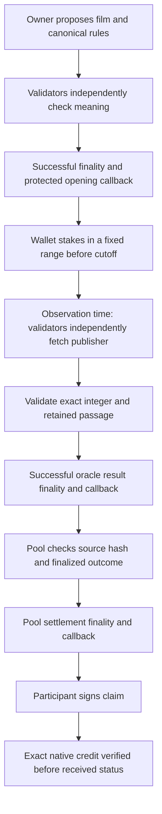
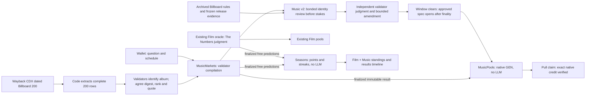

# Authority and settlement

The film oracle interprets rules and evidence; GEN pool contracts use that finalized result. The frontend owns the consumer flow and observes public state. It cannot set winners or authorize payouts.

Missing/unsuitable evidence remains pending until the frozen deadline, then permits void. A finalized void source or empty winning range refunds original entries. Source corrections after the first verified result are ignored. No administrator-entered result or source substitution exists.

## Contracts

**Bullseye v2 oracle** (`contracts/bullseye.py`) owns canonical specification checks, creator authorization, interpreted validity and extraction, exact amount normalization, interval arithmetic, evidence hashes and protected finality callbacks. Free league points derive from confirmed competitive oracle entries and resolved results; no mutable award counter can be duplicated by retries.

Both non-deterministic paths rerun substantive interpretation. Specification decisions must match. Evidence decisions match on bounded status and normalized value, and each validator verifies the leader's retained passage on the page it fetched. Execution errors never receive automatic validator agreement.

**Forecast pools** (`contracts/forecast_pools.py`) run only on StudioNet 61999. Each upcoming film has one shared pool bound to a competitive finalized open source and its specification hash. One immutable 2–100 GEN entry per wallet; fixed pre-release cutoff; no rollover. Claims await source and pool finality. Proportional cumulative integer allocation conserves the entire pot including wei dust.

**Historical sessions** (`contracts/film_pools.py`) consume already resolved sources. The first payable entry creates a shared two-minute pool atomically; later sessions preserve old claims. Known historical results are visible before entry and excluded from competitive forecasting claims.

## Client and server

Public RPC reads use pinned genlayer-js 1.1.8 and `TransactionHashVariant.LATEST_FINAL`. Successful execution and separate callback receipts matter in addition to lifecycle status. Stakes/claims are signed directly by the browser wallet. No operator key or custodial signing relay exists in Next.js.

The server can submit permissionless zero-value adjudication, void, settlement and claim verification from disposable unfunded StudioNet accounts. It accepts only listed movies and bound pool IDs; it cannot supply a result, stake or claim. Open-page polling drives this today. The daily keeper is implemented with a fixed market list, callback waits, per-film failure isolation, earlier-session pagination and a time budget. Production authentication is pending CRON_SECRET; an unset or wrong bearer token returns 401.

Both pool contracts reserve `claim(poolId, attempt)` before emitting a transfer. Permissionless `verify_claim` independently fetches the exact finalized parent and native child from the fixed Studio RPC through strict equality consensus. The pool ID, attempt nonce, sender, recipient and amount must match. A protected finality callback records paid only for explicit native credit, or failed for explicit terminal non-credit. Only failed attempts permit a new nonce; retry requires backing for all unpaid obligations. The app requests zero-value verification automatically and shows Retry collection after failure finality. [Recovery state machine and proof](CLAIM-RECOVERY.md).

## Persistence and limitations

Hosted browser storage contains guest practice, drafts and public receipt projections, keyed appropriately by wallet. It cannot authorize contract entries or payouts. Wallet-selected watch views are public projections, not authentication to private data. Alternatively, a local single-process serialized file database uses an HttpOnly guest cookie; this is unsuitable for an ephemeral or multi-process deployment.

The publisher controls source facts and availability. Retained passage hashes prove integrity of an excerpt, not permanent whole-page retention or factual truth. Film sources support The Numbers domestic opening-weekend revenue; the separate Music source and archive policy are described below. Creator authorization remains owner-only; pools cap 200 entrants and 2000 pool records. StudioNet is a development simulator; broader shared-testnet deployment, durable indexing and production monitoring remain later work.

## Adjacent Music contracts

The old Film oracle and both current Film pool addresses are preserved. Music uses separate source and pool records. `build-music-contracts.py` embeds the pure parser into a standalone pinned-runner source; the deployment helper refuses source-hash changes after recording an address. No local-only runner alias is used.

Judgment occurs only in Music compilation and album identification. Code chooses CDX captures after observation, validates dated Billboard 200 markers, requires complete ordered rows, hashes all row fields, checks exact quotes and debut weeks, and determines winners. Models see extracted bounded data, not publisher HTML. Accepted compiled identities agree in their complete canonical form. Results activate through protected finality callbacks. Archive/identity uncertainty stays pending until a fixed deadline.

MusicPools reads finalized source state, freezes its hash/deadlines, and distributes the whole pool through deterministic cumulative integer allocations. Void and empty-winner outcomes refund; unresolved sources allow a refund at the frozen source deadline plus one day. Claims use the existing verified-native-credit reservation/retry design. `verify_settlement` recovers a missed activation callback from a strictly validated finalized successful settlement receipt; it cannot invent a winner. Unknown native credit remains reserved until protocol evidence resolves it.

The server reads LATEST_FINAL only, caches and bounds directory reads, and sends zero-value permissionless maintenance requests. Wallet stakes/claims use the existing provider and never expose a key to the server. Public wallet-scoped receipt metadata survives reload; source and pool records remain authoritative. Open pages drive music resolution, settlement, claim verification, and season imports; the unconfigured daily scheduler remains inactive. Browser closures do not change contract deadlines, and another caller can execute each permissionless step.

Seasons imports finalized existing predictions rather than stake entries or administrator scores. It binds both source addresses and fixed season boundaries. Correct bins add 100, exact guesses add bounded closeness, and chronological idempotent records define hit rates and streaks. Historical exhibition remains distinct from competition. The dated proof manifest distinguishes actual network receipts from controlled browser transport and retained failed candidates.

## Music+ identity judgments

The Music+ implementation adds `music_challenges.py`, `music_markets_v2.py`, `music_pools_v2.py` and `seasons_v2.py`. Its release status and actual receipts are recorded in `docs/proofs/musicplus-2026-10-14/manifest.json`; unfinished candidates are not the production release. The original Music addresses and exact deployed source bytes remain readable through `/music/previous`. Film addresses and existing positions remain bound to their original contracts.

A creator signs one payable `list_market` call with 0.004 simulated GEN. Challenges records the funded intent and emits compilation to the bound Markets contract after finality. Compilation activates a fresh review window; delayed compilation cannot silently shorten it. The constructor defaults to 24 hours. The explicitly disclosed StudioNet demonstration uses ten minutes, with a two-hour decision deadline. Each listing permits one challenge per ground and at most four challenges, with one active case at a time. Each challenge requires an exact 0.001 GEN bond.

Validators independently fetch the fixed Billboard Wayback `id_` reference, the compiled specification and, for identity/date disputes, an allowlisted archived release announcement or permanent Wikipedia revision. Challenger arguments and fetched pages are data. Each validator repeats the judgment and compares verdict, generated option and evidence digests. It additionally checks the leader's actual quotes against its own fetched text. Passage IDs expand into exact evidence before storage; specification citations are bounded to the album identity or rank bins. No model can invent a replacement artist, title, date or bin.

Code generates week amendments at ±7/14 days, two edition policies, or the complete fixed rank-bin set. UPHELD assigns the bond to the creator; AMENDED returns the bond and a fixed 0.001 GEN reward from the listing deposit; INSUFFICIENT_EVIDENCE returns the bond. These dispositions wait until the complete review clears. VOIDED refunds all original listing/bond deposits, cancels earlier provisional rewards and permanently prevents opening. Actual source hashes and finality callbacks gate both opening and pool staking.

Every waiting state has a deadline. Missing evidence stays pending; expiry records an explicitly labelled insufficient-evidence fallback, never a claimed validator ruling. Expired/rejected compilation permits a full listing refund. Permissionless receipt-verified recovery repairs missed ruling, review and withdrawal callbacks. Exact failed listing/bond calls whose native value was credited can be refunded once to their original sender after successful independent verification of the finalized failed receipt. This cannot recover deposits sent to an older immutable contract lacking that method.

Review credits use pull withdrawals with attempt nonces. Pending transfers reserve the credit; explicit finalized native credit marks paid; explicit failure restores retry credit once. Another receipt or uncertain credit cannot unlock a duplicate payout. `npm run settle:music` journals zero-GEN maintenance hashes for restart, opens reviewed markets, creates their pools and resolves eligible charts. It never signs deposits or claims. No daily scheduler is configured; a caller must run the keeper after observation dates and retry until a complete eligible archive exists or the refund deadline applies.
