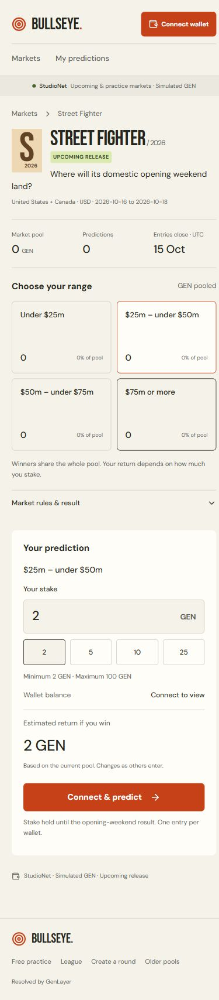

# Reviewer walkthrough

Live: [Bullseye](https://bullseye-genlayer.vercel.app). Source: [JWattjr/Bullseye](https://github.com/JWattjr/Bullseye). **StudioNet, chain 61999; GEN is simulated development currency.**

## Two-minute review, no funds required

| Time | Action | Evidence |
| --- | --- | --- |
| 0:00–0:20 | Open [Markets](https://bullseye-genlayer.vercel.app/pools). Browse Upcoming, search Dune, then clear. | Five films, ranges, release/cutoff dates and actual stake totals. |
| 0:20–0:45 | Open [Street Fighter with a selected range](https://bullseye-genlayer.vercel.app/rounds/street-fighter-2026?range=1#prediction). Inspect the 2 GEN ticket and expand Market rules & result. | One ticket, presets, pool-based estimate, fixed deadlines, unknown result. No signing required. |
| 0:45–1:10 | Choose Practice; open Barbie and expand Play for free points. Select $150m – under $200m and confirm without an exact guess. Reload. | Instant 100 practice points for $162,022,044, preserved after reload. This does not stake GEN. |
| 1:10–1:35 | Expand settlement rules and Evidence & technical record. Inspect the publisher and [oracle proof](https://bullseye-genlayer.vercel.app/protocol-proof.json). | Frozen event, exact value, passage and successful finalized adjudication/callbacks. |
| 1:35–2:00 | Inspect [historical film proof](https://bullseye-genlayer.vercel.app/film-pool-proof.json) and [upcoming proof](https://bullseye-genlayer.vercel.app/upcoming-pool-proof.json). Open My predictions. | Signed historical deposits/payouts, five open finalized sources/pools, wallet-specific portfolio. |

The main GEN ticket and secondary free-points form are separate actions. Historical results are visible before staking. Do not describe practice confirmation as a funded transaction.

## Optional live GEN demo by the wallet owner

Use the connected StudioNet wallet with at least 2 GEN. The built-in faucet in [Studio](https://studio.genlayer.com) must fund that same account; [network instructions](https://docs.genlayer.com/developers/networks) explain it. Studio and browser wallet accounts can differ.

1. Connect through the header. Choose **$150m – under $200m** in Barbie's main ticket.
2. Keep **2 GEN**, click Predict with 2 GEN, and sign in your wallet. First entry starts a shared two-minute session; an existing session uses its remaining time.
3. Open My predictions and leave a page open while the daily scheduler is inactive. Confirmation and finalized settlement update automatically.
4. Use Collect and sign once. Wait for GEN received in your wallet and a balance update. The amount depends on entries; do not promise a fixed return.

An upcoming film cannot demonstrate a quick payout: funds stay held until its future result or void. This optional flow spends development tokens and is performed by their owner. The submission does not require another broadcast.

## Independently checkable proof

- Oracle `0x756ddF8D588DA4D598F9F90947DB92Bced10D68E`: rule interpretation and publisher extraction.
- Historical pools `0xD12AaAf442A01708f4DF0C5eb0B3171C3cAb9403`: new 2 GEN Barbie deposit, exact credited payout and independently finalized paid state. Prior three-film receipts remain in the linked legacy manifest.
- Forecast pools `0xBC8b76e39B6364E16E85F5881ccC0ece5ddb9a25`: five bound open pools without predetermined winners.
- [Upcoming verification](proofs/upcoming/network-verification.json), [raw film receipts](proofs/films), [verification matrix](VERIFICATION.md).

The isolated consumer fixture demonstrates two-wallet allocation and collection without broadcasts. No live two-wallet proof, production-chain deployment or completed upcoming payout is claimed.

## Submission images

Unedited published-app captures; these are not wallet-transaction recordings:

Recorded owner demo: https://youtu.be/IUI4EQOu00M. The October 9 recovery correction is documented separately in [CLAIM-RECOVERY.md](CLAIM-RECOVERY.md); the existing video does not establish that later failure test. Run the read-only recovery verifier and the controlled browser test linked there.

## Music update: two-minute owner/reviewer script

| Time | Action | Evidence |
| --- | --- | --- |
| 0:00–0:15 | Open Film, then choose Music in the header. | Film is preserved; Billboard 200 album markets sit beside it. StudioNet simulated GEN is disclosed. |
| 0:15–0:40 | Open Renaissance and inspect its resolved #1 result. Expand How this settles. | Frozen artist/edition/week, CDX-selected complete archive, canonical row quote and full digest. |
| 0:40–1:00 | Open Surrender, Patina and the Renaissance–Surrender pairing. | Mid-chart debut, absence from a complete chart, and same-week lower-position comparison. Midnights is a separately disclosed pending archive diagnostic, not a completed result. |
| 1:00–1:20 | Open Propose; demonstrate the recorded ambiguous rejection and an accepted compiled preview. | Models compile plain English; the creator reviews the immutable spec before opening. Avoid claiming an unrecorded proposal is finalized. |
| 1:20–1:40 | Show the dated music proof's stake, settlement and verified native claim receipts when complete. | 0.01 GEN owner-approved stake; successful parent alone is insufficient. No new broadcast required for review. |
| 1:40–2:00 | Open Season, choose Historical exhibition, connect the proof wallet or show the recorded standing. | Existing Film plus finalized Music free predictions, points/closeness/streaks, separate competitive table. |

The update draft is `docs/submission/milestone-music.json`; only the owner submits it. The existing YouTube video is a Film demonstration and does not establish this new Music flow. Record an updated walkthrough with this script if the Portal asks for a new video. The live proof manifest is the source of truth for completion; missing funded proof must remain disclosed.

## Music+ production recording

The recorder is `scripts/record-musicplus-demo.ts`. Run `npx tsx scripts/record-musicplus-demo.ts` only after production serves the final verified registry, the bonded amendment is finalized and the upcoming GEN pool is open. It refuses a different deployed Challenges address. It uses Playwright at 1440×900 against production, without an injected wallet or mocked network. The recording has not been completed while those release gates remain open.

Matching captions/narration:

| Chapter | Narration | Planned seconds |
|---|---|---|
| Music directory | Real upcoming albums have unknown outcomes. All GEN here is simulated StudioNet currency. | 10 |
| Upcoming ticket | Choose a chart range and stake GEN. This upcoming result has not been settled. | 10 |
| Proposal | A plain-English question starts compilation. This exact proposal was compiled earlier; the recording sends no new deposit. | 11 |
| Actual compiled spec | The finalized specification freezes the album, chart week, entry cutoff and outcomes. | 11 |
| Identity challenge | A bonded challenge corrected the wrong chart week with a code-generated option. Independent validators checked both frozen sources. | 12 |
| Quoted evidence | The ruling retains exact rule and release quotations. The approved week is August 13, 2022. | 12 |
| Previous historical result | Renaissance resolved #1 from an archived complete 200-row chart, with its matched row and snapshot. | 12 |
| Verified pool claim | The existing 0.01 GEN claim was collected. Its finalized claim and credited native transfer are linked; no new claim is broadcast. | 12 |
| Film + Music season | Both categories share a season. Known historical results stay separate from competitive forecasts. | 12 |

The recorder removes loading intervals by cutting actual recorded video into these chapters, writes `docs/media/bullseye-musicplus-2026-10-14.webm` and a recording metadata JSON, and checks the actual output resolution and duration below 150 seconds. It does not substitute still images or fabricate transactions. Inspect the resulting recording before delivery. The owner uploads it to YouTube and replaces `OWNER_UPLOAD_NEW_MUSICPLUS_VIDEO` in the Portal draft; the earlier Film YouTube link is preserved only as prior-release evidence. Never submit the Portal automatically.
